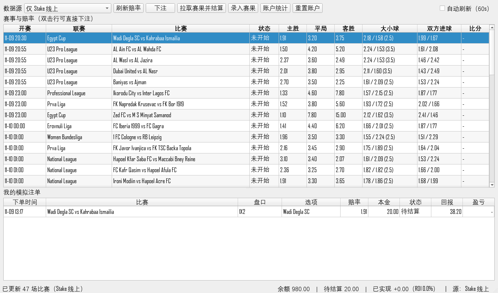

# GroundBet · Stake 足球赔率抓取 & 模拟下注

从 stake.com 读取足球赛事的 **1X2 / 大小球 / 双方进球** 赔率与比分，在本地
SQLite 模拟账户里下注、结算、统计盈亏。

> **它不做真实下注。** 全流程只读接口 + 本地记账，不会调用任何 Stake 下注
> 接口，也不接触真实资金。请自行确认抓取行为符合目标站点的服务条款。



*上图为真实抓取结果（Stake 线上，47 场足球赛事），下方是模拟注单。*

---

## 1. 功能

| 能力 | 说明 |
| --- | --- |
| 赔率抓取 | `POST /_api/v1/graphql`，`sport(sportId) { fixtureList }`，一次拉 `upcoming + live` |
| 赛果抓取 | `sportFixture(fixtureId) { eventStatus }`，按未结算注单的比赛逐个/批量查比分 |
| 盘口解析 | 只取 `main` 盘口组的 1x2 / 双方进球 / 亚盘大小球；冠军盘、让球盘等自动忽略 |
| 模拟下注 | 余额校验、重复下单拦截、金额/赔率合法性、Decimal 精确记账 |
| 自动结算 | 1X2、总进球（整数盘退款）、双方进球；未知盘口拒绝下注 |
| 账户统计 | 可用余额、待结算本金、总资产、已实现盈亏、ROI、胜率、最大回撤 |
| 图形界面 | PySide6 表格 + 下注对话框 + 手工录入赛果 + 定时自动刷新 |
| 命令行 | `probe / fetch / bet / settle / stats / demo / capture` 全流程可脚本化 |
| 离线兜底 | `fixtures/mock_events.json`，断网/被封 IP 时完整演示；真实失败会显式降级并提示 |

---

## 2. 快速开始

```bash
python -m pip install -r requirements.txt

copy .env.example .env          # Windows；macOS/Linux 用 cp
# 按第 4 节填 STAKE_ACCESS_TOKEN / STAKE_COOKIE / STAKE_USER_AGENT

python cli.py probe             # 先确认凭据和 IP 可用（应返回 ✅ 可用）
python cli.py fetch             # 抓真实赛事与赔率
python main.py                  # 图形界面

python cli.py demo              # 不联网的端到端演示（真实接口不可用时的替代）
```

---

## 3. 目录结构

```
GroundBet/
├── main.py                 # GUI 入口：组装 配置 → 数据库 → 引擎 → 窗口
├── cli.py                  # 命令行入口（不依赖 Qt）
├── config.py               # .env / 环境变量 → Settings
├── models.py               # 领域模型 + 赛果判定（纯 Python）
├── conftest.py             # pytest 夹具
├── betting/
│   ├── engine.py           # 模拟账户：下单、结算、盈亏/回撤统计
│   └── staking.py          # 固定/比例/凯利注码，去水与隐含概率
├── data/
│   ├── stake_client.py     # HTTP 客户端（仅读取）
│   ├── stake_v1.py         # 真实 schema 的查询构造与解析
│   ├── stake_graphql.py    # 查询语句（可被 queries/*.graphql 覆盖）
│   ├── stake_parse.py      # 通用容错解析（用于导入抓包 JSON）
│   ├── providers.py        # Stake / 离线 / 自动降级 三种数据源
│   ├── fetcher.py          # Qt 后台线程
│   └── match_model.py      # 赛事表格模型
├── storage/repository.py   # SQLite：赛事、赔率快照、注单、赛果、元数据
├── ui/                     # 主窗口、下注对话框、赛果对话框、注单模型
├── fixtures/mock_events.json
├── queries/                # 抓包覆盖查询（可选）
└── tests/                  # 55 个单元测试
```

---

## 4. 配置（.env）

| 变量 | 默认值 | 说明 |
| --- | --- | --- |
| `STAKE_ACCESS_TOKEN` | — | 请求头 `x-access-token`，浏览器 F12 复制 |
| `STAKE_COOKIE` | — | 整条 Cookie（推荐），含 `cf_clearance`、`__cf_bm` 等 |
| `STAKE_CF_CLEARANCE` | — | 只填 `cf_clearance` 时的简写 |
| `STAKE_USER_AGENT` | Chrome 135 | **必须**与签发 Cookie 的浏览器完全一致 |
| `STAKE_API_BASE` | `https://stake.com` | 换镜像/网关时用 |
| `STAKE_PROXY` | — | 例如 `http://127.0.0.1:7890`（SOCKS 需 `pip install "requests[socks]"`） |
| `STAKE_SPORT_ID` | 足球 UUID | `5b4b60b9-ed95-41e7-97e3-f33aa172cf12`；接口**只认 UUID**，不认 `soccer` |
| `STAKE_EVENT_LIMIT` | 50 | 每类（upcoming / live）返回条数 |
| `STAKE_TIMEOUT` | 25 | 秒 |
| `GROUNDBET_DATA_SOURCE` | `auto` | `auto` 真实优先、失败降级离线；`stake` 只连线上；`mock` 只用离线 |
| `GROUNDBET_BALANCE` | 1000 | 模拟账户初始资金 |
| `GROUNDBET_REFRESH` | 60 | 自动刷新间隔（秒），最小 10 |
| `GROUNDBET_DB` | `data/groundbet.db` | SQLite 路径 |

`auto` 模式降级时**不会静默**：界面顶部显示黄色提示条，状态栏标注数据源，
命令行打印 `⚠ 真实数据源不可用…`。

---

## 5. 抓取实现与排错

真实接口是 SvelteKit 前端的 GraphQL（Cosmo Router，**Introspection 已关闭**），
schema 由线上响应反推：

```graphql
Query.sport(sportId: String!)            -> Sport
Query.sportFixture(fixtureId: String!)   -> SportFixture
Sport.fixtureList(limit: Int, type: SportSearchEnum)  # upcoming / live / all

SportFixture.data        是 union: ... on SportFixtureDataMatch { startTime teams { name qualifier } }
SportFixture.eventStatus 是 union: ... on SportFixtureEventStatusData { homeScore awayScore matchStatus }
SportFixture.groups -> SportGroup -> templates -> markets -> outcomes { name odds active }
```

解析规则（`data/stake_v1.py`）：

- 只取 `main` 组，模板 `extId`：`1` = 1x2，`29` = 双方进球，`18` = 亚盘大小球；
- 大小球只接受 `.0` / `.5` 盘口（`2.25` / `2.75` 四分之一球需要拆盘，暂不解析）；
- `SportFixtureDataOutright`（冠军盘）与没有可下注盘口的场次直接跳过；
- 比分取 `eventStatus.homeScore/awayScore`，状态由 `matchStatus` 映射。

常见失败与处理：

| 现象 | 原因 | 处理 |
| --- | --- | --- |
| 403 + `ip-blocked` | 出口 IP 被地区/机房封禁 | 换住宅网络，或配 `STAKE_PROXY` |
| 403 + `Just a moment` | Cookie 过期、UA 不匹配、IP 被风控 | 重新复制完整 Cookie + UA；仍不行则走代理 |
| 401 / 419 | access token 失效 | 重新登录后复制 |
| `Cannot query field …` / `variable … never used` | schema 或查询变了 | 把 F12 抓到的 `query` 存成 `queries/events.graphql` |
| 成功但 0 场比赛 | `STAKE_SPORT_ID` 不是足球，或字段解析失效 | 检查 sportId；用 `python cli.py fetch --dump` 看原始结构 |

**抓包覆盖**：浏览器打开体育页 → F12 → Network → `_api/v1/graphql` → 复制请求体的
`query`，存为 `queries/events.graphql`。程序会优先用它，变量需使用 `$sportId`
和 `$limit`（Cosmo Router 拒绝声明了却没用到的变量）。

**请求被拦但浏览器能看**：把响应 JSON 存下来 `python cli.py capture response.json` 导入。

**演示数据不会混进真实数据**：每场比赛和每张注单都记录了 `source`（`stake` / `mock`）。
成功抓到线上数据后会自动删除全部 `mock` 数据（比赛、注单、赔率快照、赛果），
余额按公式重算，界面提示「已清理离线演示数据…」；演示账户的盈亏不会残留。
手动清理用 `python cli.py clean-demo`。老数据库首次打开会自动补 `source` 列，
并按 `mock-` 前缀把历史演示数据标记出来。

---

## 6. 模拟下注规则

- 余额公式：`可用余额 = 初始资金 + 已实现盈亏 − 未结算本金`，总资产再加回未结算本金。
- 下单即扣本金；结算时赢返还 `本金 × 赔率`，输返还 0，退款返还本金。
- 同一比赛 + 同一盘口 + 同一选项**不允许同时挂多张待结算注单**。
- 只能对未开始/进行中的比赛下注；已录赛果的比赛会被拒绝。
- 结算规则：

| 盘口 | 判定 |
| --- | --- |
| 1X2（含二选一） | 按比分判胜负平 |
| 总进球 | 总进球 > 盘口 → 大；< → 小；**等于整数盘口 → 退款** |
| 双方进球 | 两队都进球 → 是 |
| 其它盘口 | 不可下注，避免产生永远无法结算的注单 |

- 结算会同时把比赛标记为已结束并写入比分；重复结算不会重复记盈亏。
- 手工录入赛果（GUI「录入赛果」或 `cli.py settle --event … --score 2-1`）走同一套逻辑。

---

## 7. 命令行速查

```bash
python cli.py probe [--introspect]        # 凭据 / IP 自检
python cli.py fetch [--dump out.json]     # 抓取并缓存（含赔率快照）
python cli.py events [--all]              # 查看缓存赛事（默认只显示未结束）
python cli.py bets [--all]                # 查看注单
python cli.py bet --event b259fbec --market 1x2 --outcome home --stake 50
python cli.py settle --event b259fbec --score 2-1
python cli.py settle                      # 按已抓到/已录入的赛果批量结算
python cli.py results                     # 为待结算注单拉取比分并结算
python cli.py stats                       # 账户统计
python cli.py reset [--results]           # 重置账户 / 赛果缓存
python cli.py clean-demo                  # 删除库里的离线演示数据
python cli.py demo                        # 离线端到端演示
```

所有子命令支持 `--source {auto,stake,mock}` 与 `--db 路径`。
`--event` 支持完整 UUID 或唯一前缀（如 `b259fbec`）。

---

## 8. 测试

```bash
python -m pytest -q
```

覆盖：赛果判定（胜平负/大小球/退款/双方进球）、余额与盈亏公式、重复下单与余额不足拦截、
结算幂等、赔率快照去重、数据来源标记与演示数据清理、真实 schema 解析（union、冠军盘过滤、
四分之一球、别名批量查询）、容错解析、离线数据源与自动降级、GUI 冒烟。

---

## 9. 已知限制

- 只处理足球；其它运动需要换 `STAKE_SPORT_ID` 并补盘口映射。
- 接口没有「历史赛果」查询：结算时按未结算注单的比赛逐个查 `sportFixture`，
  因此只能结算**你下过注**的比赛；未下注的历史比分不会入库。
- 每次抓取最多 `upcoming` / `live` 各 `STAKE_EVENT_LIMIT`（默认 50）场，无分页。
- 只解析 1X2 / 双方进球 / 亚盘大小球；让球、正确比分、半全场等显示不了也下不了。
- 时间统一存 UTC，界面按本地时区显示。

---

## 10. 合规提示

本项目仅用于个人学习、赔率研究与**模拟**资金管理。抓取行为可能受目标站点服务条款
约束，请自行评估风险；请勿将其用于绕过访问限制、自动化真实投注或任何违法行为。
